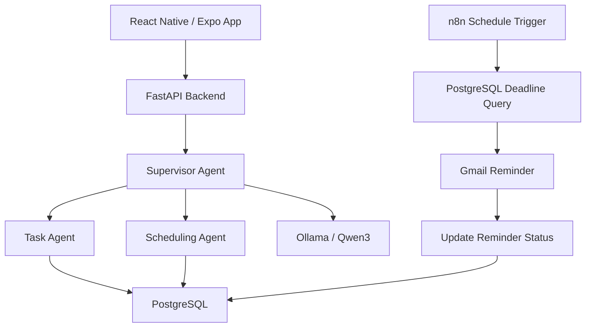

# AI Task Manager — Multi-Agent AI Application

An AI-powered task management application that combines **agentic AI, natural language processing, PostgreSQL, Docker, workflow automation, and CI/CD** into an end-to-end system.

The application allows users to manage tasks through a mobile interface and communicate with AI agents using natural language. Automated workflows monitor upcoming deadlines and send email reminders.

## Features

- **AI-powered task management:** Create, retrieve, update, complete, and delete tasks using natural language.
- **Multi-agent architecture:** A supervisor routes requests to specialized task management and scheduling agents.
- **Intelligent scheduling:** Convert natural-language deadlines into structured date and time values.
- **Persistent storage:** PostgreSQL stores tasks, completion states, deadlines, and reminder history.
- **Automated reminders:** n8n monitors upcoming deadlines and sends notifications through Gmail.
- **Cross-platform frontend:** React Native with Expo provides an interactive task management interface.
- **Local LLM:** Ollama runs the Qwen3 language model without requiring a paid cloud LLM API.
- **Containerization:** Docker Compose manages the backend, PostgreSQL, and n8n services.
- **Continuous integration:** GitHub Actions checks Python syntax, runs available tests, and validates the Docker image build.

## Technology Stack

| Layer | Technologies |
|---|---|
| Frontend | React Native, Expo, TypeScript |
| Backend | Python, FastAPI, Uvicorn |
| AI | Ollama, Qwen3, specialized AI agents |
| Database | PostgreSQL 17, psycopg |
| Automation | n8n, Gmail API, OAuth 2.0 |
| Infrastructure | Docker, Docker Compose |
| CI | GitHub Actions |
| Development | Git, GitHub, VS Code, Ubuntu WSL2 |

## System Architecture



The FastAPI backend provides the application API. The supervisor agent interprets user requests and delegates task operations or scheduling operations to specialized agents.

PostgreSQL stores task data, while n8n independently checks upcoming deadlines and triggers email reminders.


## Project Structure

```text
ai-task-manager/
├── agents/
│   ├── __init__.py
│   ├── supervisor.py
│   ├── task_agent.py
│   ├── scheduling_agent.py
│   ├── task_tools.py
│   └── ollama_client.py
├── backend/
│   ├── main.py
│   ├── database.py
│   ├── requirements.txt
│   └── Dockerfile
├── mobile/
│   ├── App.tsx
│   ├── package.json
│   └── assets/
├── n8n/
│   └── deadline-reminder.json
├── .github/
│   └── workflows/
│       └── ci.yaml
├── compose.yaml
├── .dockerignore
├── .gitignore
├── .env.example
└── README.md
```


## Getting Started

### Prerequisites

- Docker and Docker Compose
- Git
- Node.js and npm
- Ollama with the required Qwen3 model

### 1. Clone the repository

```bash
git clone https://github.com/adham1nassar/ai-task-manager.git
cd ai-task-manager
```

### 2. Configure environment variables

Create a `.env` file in the project root using `.env.example` as a reference.

Configure the PostgreSQL username, password, and database name.

Do not commit `.env` or credentials to GitHub.

### 3. Start Ollama

Install Ollama and download the model:

```bash
ollama pull qwen3:4b-instruct-2507-q4_K_M
```

Ensure Ollama is running and accessible to the Docker backend. The supplied Compose configuration uses `host.docker.internal:11434` for the Ollama connection.

### 4. Start Docker services

```bash
docker compose up -d --build
```

The application services are available at:

| Service | Local URL |
|---|---|
| FastAPI | http://localhost:8001 |
| API Documentation | http://localhost:8001/docs |
| n8n | http://localhost:5678 |
| PostgreSQL | localhost:5432 |

### 5. Start the frontend

```bash
cd mobile
npm install
npx expo start --web
```

Open the local address provided by Expo, typically `http://localhost:8081`.

The frontend must be configured to use the appropriate FastAPI address.

### 6. Configure automated reminders

In n8n, create a workflow that:

1. Runs on a schedule.
2. Queries PostgreSQL for incomplete tasks due within the next 24 hours.
3. Filters tasks that have not received a reminder.
4. Generates an email reminder.
5. Sends the email using Gmail.
6. Records the reminder timestamp in PostgreSQL to prevent normal repeat sends.

Gmail OAuth credentials must be configured separately. They are not included in this repository.

## AI Agent Architecture

**Supervisor Agent:** Determines the intent of the user request and delegates the operation to the appropriate specialized agent.

**Task Agent:** Handles task management operations such as creating, retrieving, updating, and deleting tasks.

**Scheduling Agent:** Interprets scheduling requests and converts natural-language deadlines into structured timestamps.

**Task Tools:** Perform database operations and provide the agents with access to persistent task records.

**Ollama Client:** Connects the application to the locally hosted Qwen3 language model.

## CI Pipeline

GitHub Actions automatically runs when changes are pushed to the `main` branch or a pull request targets `main`.

The workflow performs:

- Python dependency installation
- Python syntax validation
- Backend tests when a test directory is available
- Docker image build validation

The pipeline currently performs continuous integration. Automated deployment is not yet configured.

## Future Improvements

- Automated backend and integration tests
- Production-ready authentication
- Push notifications
- Improved scheduling and timezone handling
- Observability and application monitoring
- Kubernetes deployment
- Automated deployment pipeline

## Author

**Adham Nassar**

B.Sc. Applied Artificial Intelligence — TH Rosenheim

[GitHub](https://github.com/adham1nassar) | [LinkedIn](https://www.linkedin.com/in/adham1nassar)
